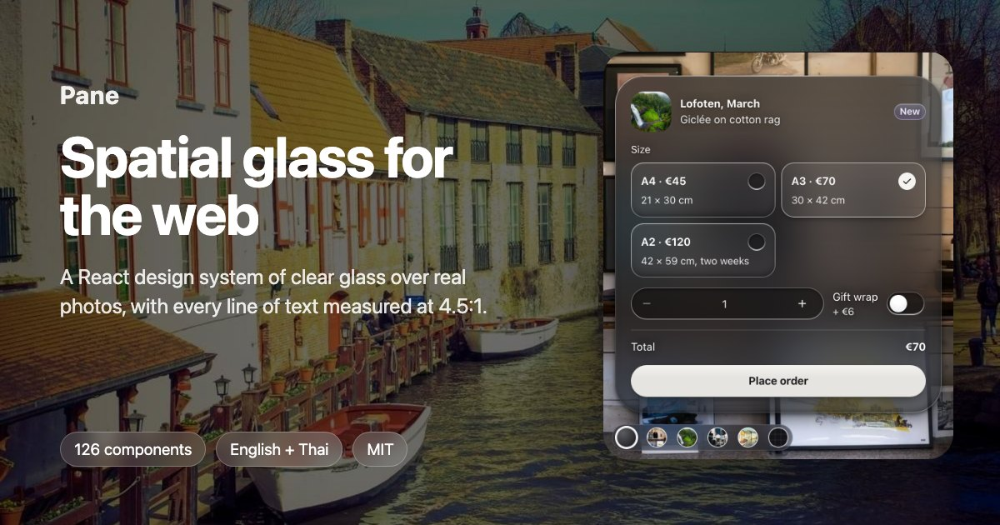

# Pane

**Spatial glass for the web.** A React design system of clear, blurred glass over real photos, with
every line of text measured for contrast, pixel by pixel, in light and dark.

[](https://pane-design-system.pages.dev)

**[Open the book](https://pane-design-system.pages.dev)**: every component with live demos, the foundations
with playgrounds, patterns, the accessibility evidence and the full token reference.

- **126 components** in 17 families, from layout and forms to charts, a data grid, a command palette and
  pieces for AI agents. The tokens come inside, so this is the only package you need.
- **Measured, not guessed.** The book publishes its contrast evidence. At the last full run, 1,001,729 of
  1,001,774 text checks passed in light and dark, in normal, reduced-transparency and forced-colours modes,
  over the book's photo backdrops. The book lists the rest, with an exception record or as an open fix.
- **English and Thai.** Every message comes in both languages, and the calendar writes the Buddhist year in Thai.
- **Tokens for every platform** from one source. CSS, JS, SCSS, Tailwind, SwiftUI, Jetpack Compose, Flutter
  and Figma variables, three tiers, with ten sample brands.
- **Ready for coding agents.** There is an MCP server (`npx pane-mcp`), a skill, `llms.txt` and `DESIGN.md`,
  and the home page has a one-line setup prompt for Claude Code, Cursor, Codex or Copilot.

## Install

```bash
npm install pane-react
```

```tsx
import 'pane-react/all.css';   // tokens and component styles, once at the root
import { Environment, Container, Card, Button } from 'pane-react';

export function App() {
  return (
    <Environment brightness="bright">
      <Container>
        <Card as="section" aria-labelledby="t">
          <h2 id="t">Lysefjord</h2>
          <Button>Follow</Button>
        </Card>
      </Container>
    </Environment>
  );
}
```

React 18 or newer. Light and dark themes, glass or solid surfaces, and reduced motion and forced colours
are all supported.

Or let your agent do it. Paste this into Claude Code, Cursor, Codex or Copilot:

```text
Fetch https://pane-design-system.pages.dev/agent-setup/prompt.md and follow it to set up Pane in this project. Ask me before you install anything.
```

## Work on it

```bash
pnpm install
pnpm run tokens:build     # packages/tokens → build/
pnpm run docs:dev         # the docs book with hot reload
pnpm run docs:build       # builds pane-react, then the book into apps/docs/dist
```

| Path | What it is |
|---|---|
| `packages/tokens` | DTCG token sources (`src/*.json`) and the build |
| `packages/react` | the components, one folder each, with their reasons (`<Name>.why.json`) |
| `apps/docs` | the docs book (Vite + React) |
| `system/` | the concept, decisions, exceptions and the review log behind every choice |

Pane was built with [kiln](https://github.com/tanawitchsaentree/Kiln), a factory for design systems that
measures what it builds.

## Licence

MIT, see [LICENSE](LICENSE). Scene photographs are from Unsplash and are credited in the book's
Credits page.
